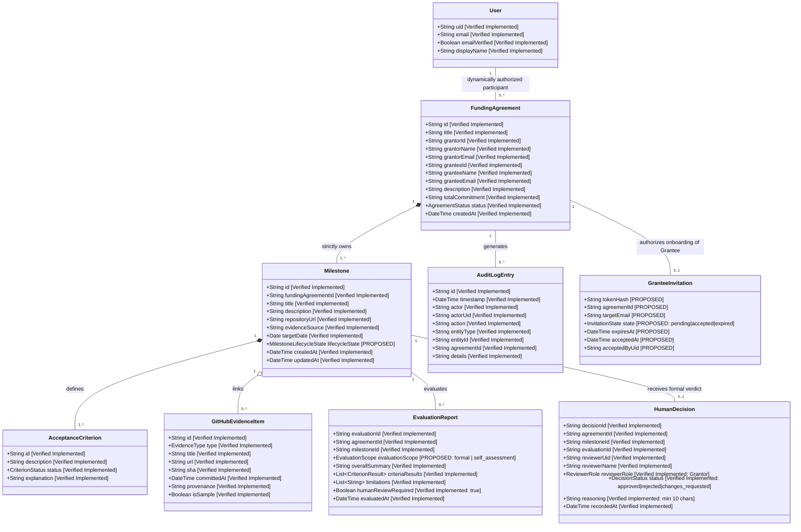
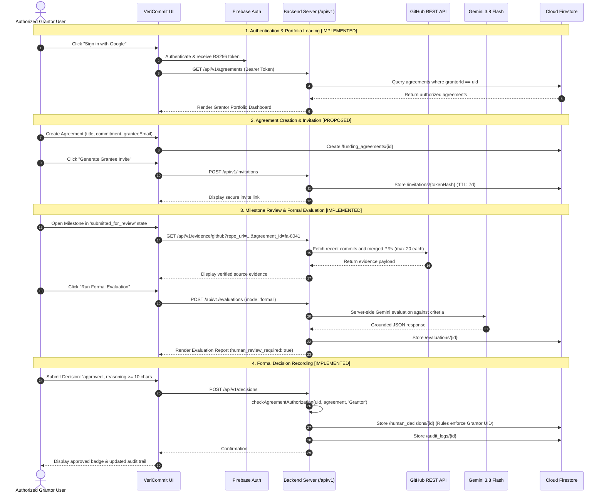
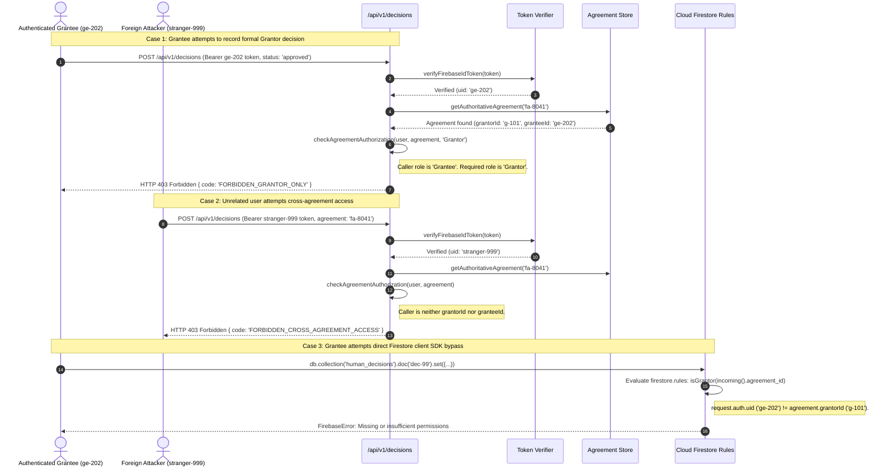
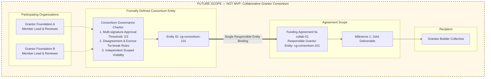

# VeriCommit Domain Diagrams Specification

**Document status:** Approved Domain Diagrams Specification  
**Scope:** UML Architecture, Use Cases, Sequences, and Data Relationships  
**Project:** VeriCommit (`Pafekzy/product-poc1`)

---

## 1. Overview

This document consolidates the complete set of UML diagrams governing VeriCommit's architecture, data relationships, role-specific user journeys, and authorization models.

All diagrams strictly adhere to confirmed governance rules:
- Exactly **one** responsible Grantor entity per Funding Agreement.
- Exactly **one** Grantee entity per Funding Agreement.
- Milestone review and formal decision authority reside exclusively with the responsible Grantor.
- Grantee AI-assisted self-assessment is distinct from formal Grantor review.
- Collaborative Grantors are explicitly documented as **FUTURE SCOPE — NOT MVP**.

---

## 2. UML A — Use-Case Diagram

Depicts role-specific capabilities for Grantors and Grantees alongside shared domain services.

```mermaid
flowchart TD
    subgraph Actors
        G[Grantor / Reviewer]
        GE[Grantee / Builder]
        U[Unauthenticated Visitor]
    end

    subgraph Public Portal [PROPOSED SEPARATION]
        UC_Home[Explore Public Homepage & Value Proposition]
        UC_Auth[Authenticate via Google OAuth]
    end

    subgraph Grantor Workspace [PARTIALLY IMPLEMENTED - REFINING]
        UC_G_Overview[View Portfolio & Review Workload]
        UC_G_CreateAg[Create Funding Agreement]
        UC_G_Invite[Generate Grantee Invitation - PROPOSED]
        UC_G_LockCriteria[Review & Lock Milestone Criteria]
        UC_G_Eval[Run/Inspect Formal AI Evaluation - IMPLEMENTED]
        UC_G_Decide[Record Formal Decision with Rationale - IMPLEMENTED]
        UC_G_Audit[Inspect Agreement Audit History - IMPLEMENTED]
    end

    subgraph Grantee Workspace [PARTIALLY IMPLEMENTED - REFINING]
        UC_GE_Accept[Validate Invitation & Onboard Repo - PROPOSED]
        UC_GE_ViewAg[View Project Agreement & Deliverables]
        UC_GE_SelfEval[Run Private Advisory Self-Assessment - PROPOSED MODE]
        UC_GE_Submit[Submit Milestone for Formal Review - PROPOSED LIFECYCLE]
        UC_GE_Outcome[View Grantor Decision & Feedback - IMPLEMENTED]
    end

    subgraph Shared Capabilities [VERIFIED IMPLEMENTED]
        UC_Evidence[Inspect Verified GitHub Evidence]
        UC_Citations[Inspect Criteria Findings & Limitations]
    end

    U --> UC_Home
    U --> UC_Auth

    G --> UC_G_Overview
    G --> UC_G_CreateAg
    G --> UC_G_Invite
    G --> UC_G_LockCriteria
    G --> UC_G_Eval
    G --> UC_G_Decide
    G --> UC_G_Audit
    G --> UC_Evidence
    G --> UC_Citations

    GE --> UC_GE_Accept
    GE --> UC_GE_ViewAg
    GE --> UC_GE_SelfEval
    GE --> UC_GE_Submit
    GE --> UC_GE_Outcome
    GE --> UC_Evidence
    GE --> UC_Citations
```



---

## 3. UML B — Domain Class Diagram

Represents domain entities, persistence structures, multiplicities, and implementation statuses.



---

## 4. UML C — Grantor Journey Sequence Diagram

Shows Grantor authentication, portfolio management, milestone review, evidence inspection, formal AI evaluation, and decision recording.



---

## 5. UML D — Grantee Journey Sequence Diagram

Shows Grantee invitation redemption, milestone inspection, private self-assessment, formal submission, and decision feedback.

```mermaid
sequenceDiagram
    autonumber
    actor Grantee as Authorized Grantee User
    participant Web as VeriCommit UI
    participant Auth as Firebase Auth
    participant API as Backend Server (/api/v1)
    participant GH as GitHub REST API
    participant AI as Gemini 3.8 Flash
    participant DB as Cloud Firestore

    Note over Grantee,DB: 1. Secure Onboarding via Invitation [PROPOSED]
    Grantee->>Web: Open Invitation Link (/invite?token=sec_abc123)
    Grantee->>Web: Sign in with Google (OAuth)
    Web->>Auth: Authenticate
    Web->>API: POST /api/v1/invitations/accept (token, repoUrl)
    API->>API: Validate token not expired & email matches targetEmail
    API->>DB: Transaction: set agreement.granteeId = uid; mark invite accepted
    DB-->>API: Success
    API-->>Web: Route directly to Grantee Project Workspace

    Note over Grantee,DB: 2. Delivery & Private Self-Assessment [PROPOSED MODE]
    Grantee->>Web: View locked acceptance criteria & target dates
    Grantee->>Web: Inspect repository evidence (/api/v1/evidence/github)
    API->>GH: Fetch live commits/PRs
    GH-->>API: Return evidence
    Grantee->>Web: Click "Run Advisory Self-Assessment"
    Web->>API: POST /api/v1/evaluations (mode: 'self_assessment')
    API->>AI: Evaluate criteria against evidence
    AI-->>API: Return findings
    API-->>Web: Render Self-Assessment Report (Advisory Only)
    Note over Grantee,Web: Grantee sees Criterion 2 is "insufficient_evidence".<br/>Pushes additional tests to GitHub before formal submission.

    Note over Grantee,DB: 3. Milestone Submission & Outcome Inspection [IMPLEMENTED / PROPOSED]
    Grantee->>Web: Click "Submit Milestone for Formal Review"
    Web->>DB: Update milestone lifecycleState -> 'submitted_for_review'
    Note over Grantee,Web: Grantor conducts formal review...
    Grantee->>Web: View Milestone Details / Realtime Firestore Sync
    DB-->>Web: Realtime update with /human_decisions/{id}
    Web-->>Grantee: Display formal decision ('approved') and Grantor rationale
```

---

## 6. UML E — Authorization and Decision Sequence Diagram

Shows server-side enforcement blocking unauthorized actions and cross-agreement tampering.



---

## 7. UML F — Future Collaborative-Grantor Concept (FUTURE SCOPE — NOT MVP)

Explicitly documents the architecture required if independent Grantor organizations associate in future releases.



---

## 8. Related Documentation

- [Domain Entities](DOMAIN_ENTITIES.md)
- [Domain Rules](DOMAIN_RULES.md)
- [Entity Relationships](ENTITY_RELATIONSHIPS.md)
